# Constellation AI Assistant plugin

An **AI Assistant** for [Constellation](https://github.com/constellation-app/constellation), packaged as a
separately distributed NetBeans plugin (`.nbm`). It adds an *Assistant* view where you chat with a large
language model that can inspect the active graph, query and select elements, run Constellation plugins and
Data Access View plugins, add records, and undo its own changes — with your approval for anything that
modifies the graph.

The plugin is built against a compiled Constellation and installed through Constellation's existing
**Setup > Plugins** dialog. No changes to the Constellation code base are needed.

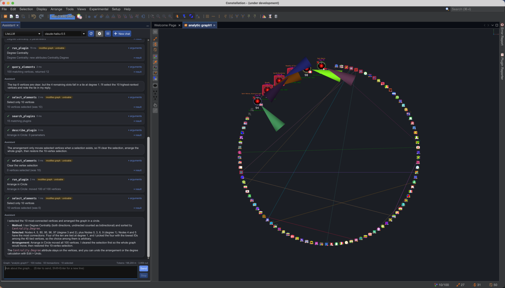

- [Features](#features)
- [Installing the plugin](#installing-the-plugin)
- [Setting up a model](#setting-up-a-model)
- [Using the Assistant](#using-the-assistant)
- [Building the plugin](#building-the-plugin)
- [Distributing the plugin](#distributing-the-plugin)
- [How it works](#how-it-works)
- [Repository layout](#repository-layout)

---

## Features

- **Chat with your graph.** Each message is sent with a short summary of the active graph (name, schema,
  size, selection), so you can just ask "summarise this graph" or "which vertices are the most central?".
- **Works with any OpenAI-compatible or Anthropic API**: OpenAI, Anthropic, Azure OpenAI, vLLM, LM Studio,
  LiteLLM and other gateways. Configure as many endpoints as you like and switch
  between them, and between their models, from drop-downs at the top of the view.
- **Tools that act on Constellation.** The model works in steps, calling tools and reading their results:

  | Tool | What it does | Default policy |
  |---|---|---|
  | `get_graph_summary`, `list_graphs`, `get_attributes` | Describe the open graphs and their attributes | Auto |
  | `query_elements`, `attribute_stats`, `get_selection` | Find, sort and summarise vertices and transactions | Auto |
  | `select_elements` | Change the selection (undoable) | Auto |
  | `search_plugins`, `describe_plugin` | Find Constellation plugins and their parameters | Auto |
  | `run_plugin` | Run an analytic, arrangement or other plugin (undoable) | Ask |
  | `list_data_access_plugins`, `run_data_access_plugin` | Find and run Data Access View plugins | Auto / Ask |
  | `add_records` | Add vertices and transactions (undoable) | Ask |
  | `set_active_graph`, `undo_last_change` | Switch graphs, undo the last change | Ask |

- **You stay in control.** Tools that change the graph or query external systems show an approval card:
  **Approve**, **Always allow** (for the rest of the chat), **Edit JSON** (change the arguments first) or
  **Deny…** with an optional reason that is passed back to the model. Every change runs as a normal
  Constellation plugin, so it can also be undone with *Edit > Undo*. Per-tool policies (AUTO / ASK / NEVER)
  are set in the options.
- **Streaming answers rendered as Markdown**, with a card for every tool call showing its arguments, result
  and timing, plus token counts for the chat.
- **Per-chat settings** (⚙): temperature, reasoning effort (e.g. *none* to make small models faster) and the
  maximum number of steps per message.
- **Uses Constellation's security settings.** Requests use Constellation's client certificate (mTLS) when
  one is configured and its proxy settings.
- **Safety measures**: password parameters are never exposed to the model, secret-looking arguments are
  masked on tool cards, and graph contents are treated as data rather than instructions.
- **Transcripts** can be copied or exported as Markdown or JSON (⋯ menu).
- **Extensible.** Other plugins can add tools by implementing `AgentTool`
  (`au.gov.asd.tac.constellation.views.aiagent.api`) and registering it with
  `@ServiceProvider(service = AgentTool.class)`.

---

## Installing the plugin

You need the plugin file, `au-gov-asd-tac-constellation-views-aiagent.nbm` (see
[Building the plugin](#building-the-plugin), or get it from whoever distributes it). It contains everything
the plugin needs, including its third-party libraries.

### Option A — install the `.nbm` file

1. In Constellation open **Setup > Plugins**.

   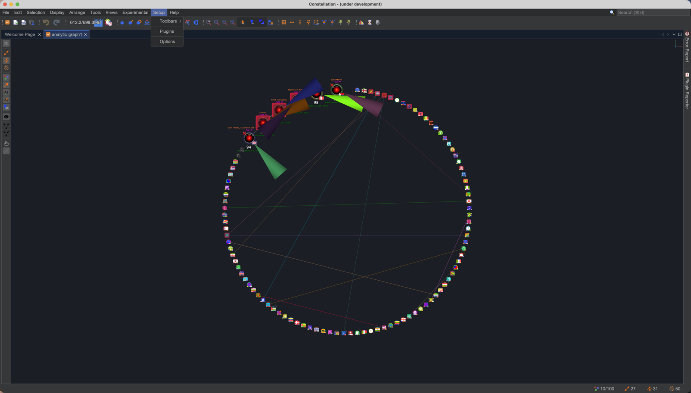

2. Go to the **Downloaded** tab and click **Add Plugins…**.

   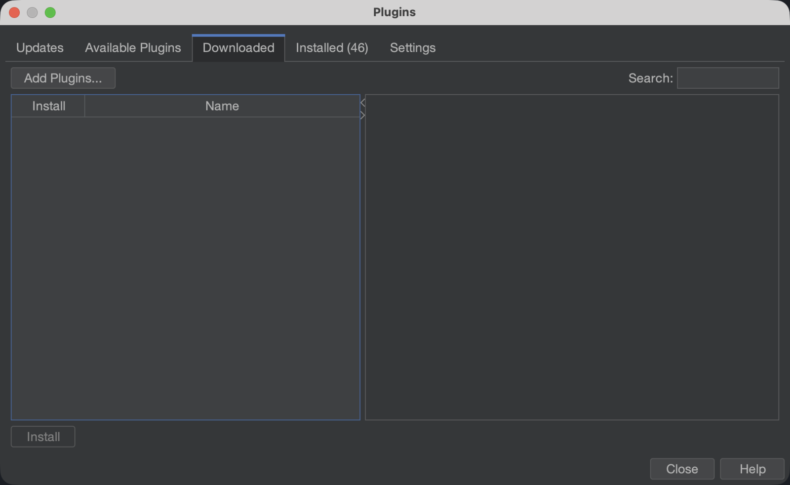

3. Select `au-gov-asd-tac-constellation-views-aiagent.nbm` and click **Open**.

   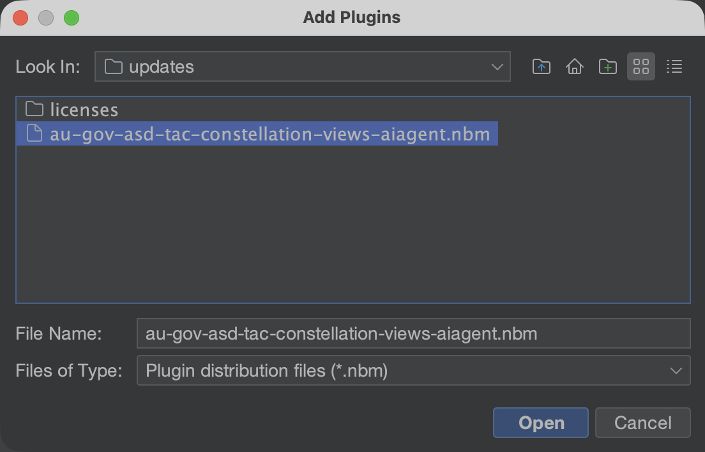

4. **AI Assistant** appears in the list, ticked. Click **Install**.

   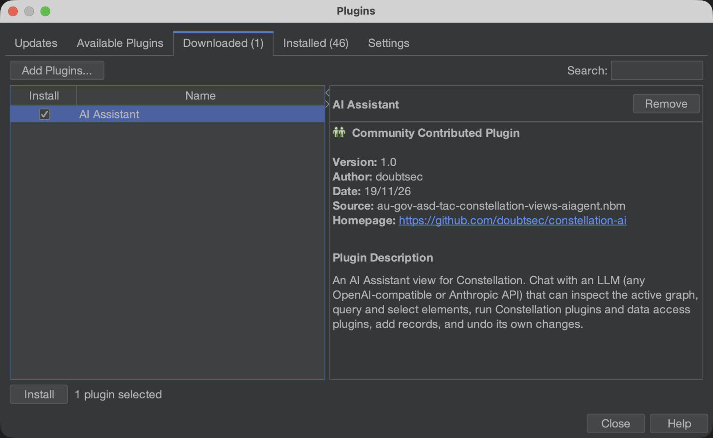

5. Click **Next**, accept the licence (Apache 2.0) and click **Install**.

   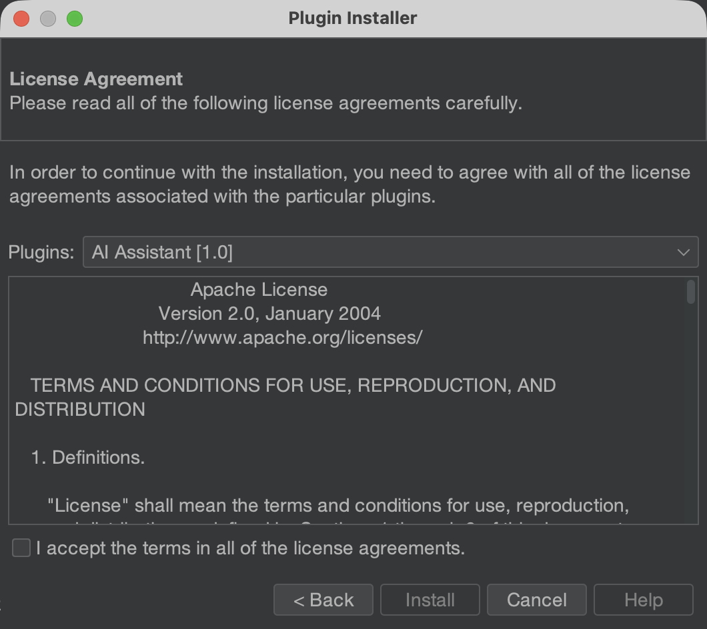

6. If the plugin isn't signed, Constellation warns you that it is an unsigned third-party plugin; click
   **Continue** if you trust where it came from (see [Signing](#signing-the-nbm) to avoid this).

   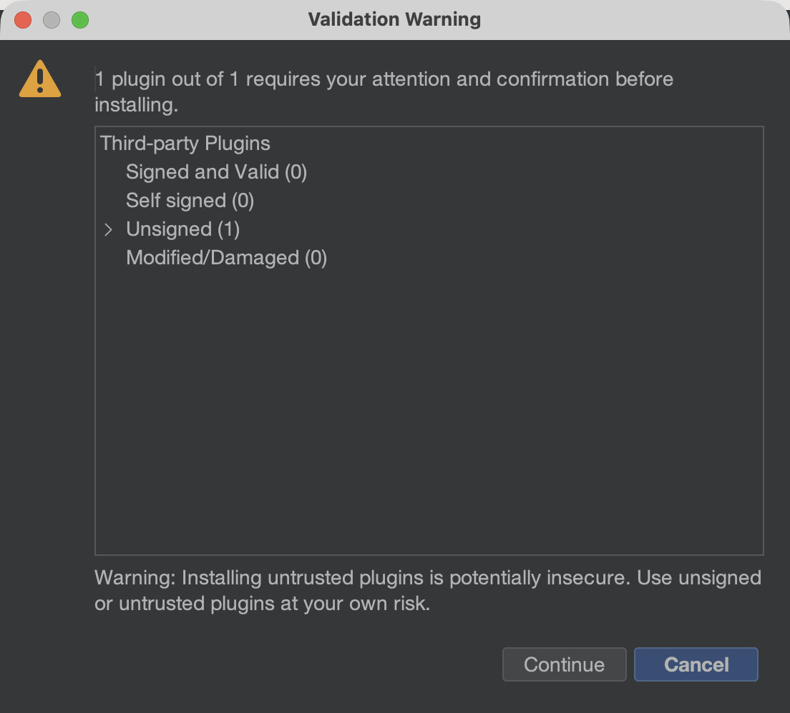

7. Click **Finish**. No restart is needed.

   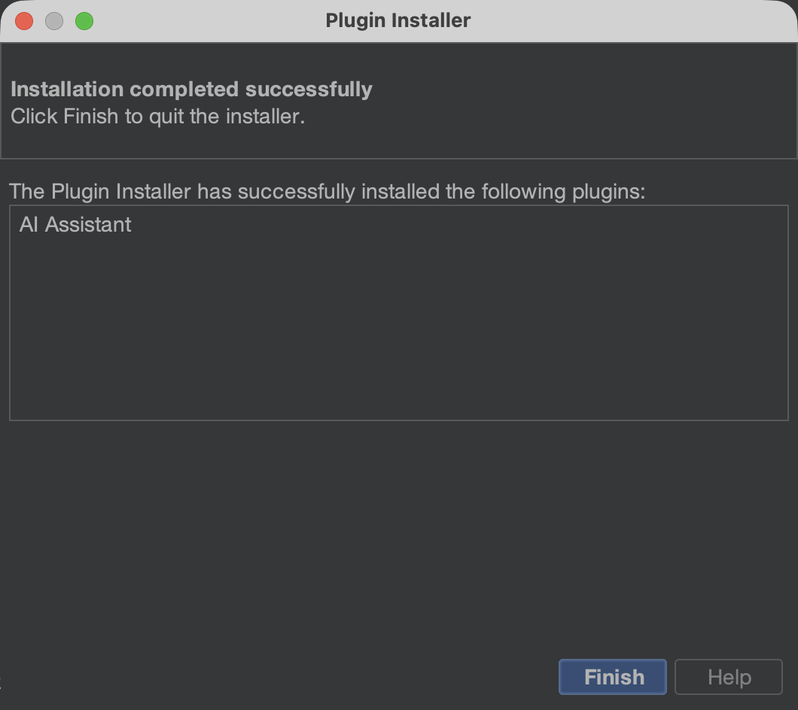

### Option B — install from an update centre

If the plugin is published as an update centre (see [Distributing the plugin](#distributing-the-plugin)):

1. Open **Setup > Plugins > Settings**, click **Add**, give it a name and enter the URL of its
   `updates.xml` (an `https://…` or `file:/…` URL), and click **OK**.
2. Open the **Available Plugins** tab, tick **AI Assistant** and click **Install**.

New versions published to the update centre then show up in the **Updates** tab.

### After installing

The Assistant is in **Views > Assistant** (<kbd>Ctrl+Shift+K</kbd>).

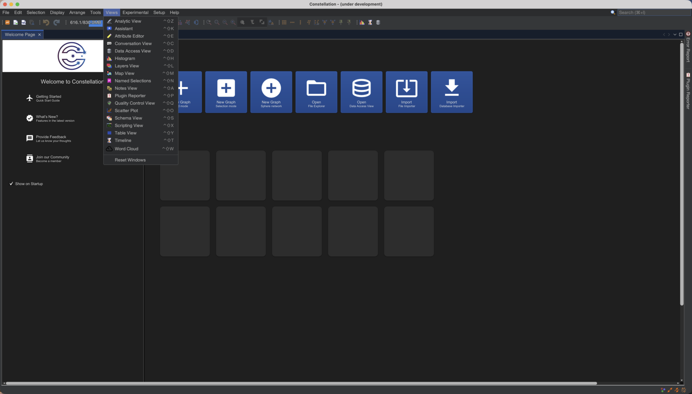

The plugin is installed into your Constellation user directory, so it survives Constellation restarts and
upgrades of Constellation itself. To turn it off or remove it, find **AI Assistant** in
**Setup > Plugins > Installed** and click **Deactivate** or **Uninstall**.

---

## Setting up a model

The Assistant doesn't come with a model. The first time you open it, it asks you to configure one.

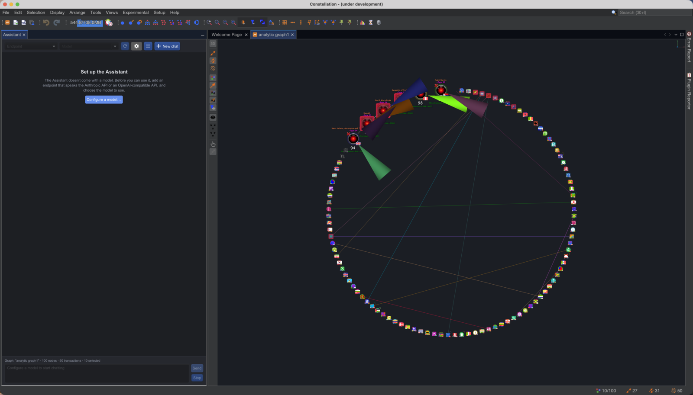

1. Click **Configure a model…** (or open **Setup > Options > Constellation > Assistant**).
2. On the **Endpoints** tab click **Add** and fill in:
   - **Name** — anything, e.g. `LiteLLM`.
   - **Kind** — *OpenAI-compatible* or *Anthropic* (the API the server speaks).
   - **Base URL** — e.g. `https://api.openai.com/v1`, `https://api.anthropic.com/v1` or
     `http://localhost:4000/v1` for a local LiteLLM proxy.
   - **Extra headers** (optional) — one `Name: value` per line, sent with every request (useful for
     gateways).
   - **Key** — the API key, if the endpoint needs one. Keys are stored in Constellation's preferences. For
     Anthropic endpoints with no key saved, the `ANTHROPIC_API_KEY` environment variable is used.
3. Click **Test connection**. It lists the models the endpoint offers.

   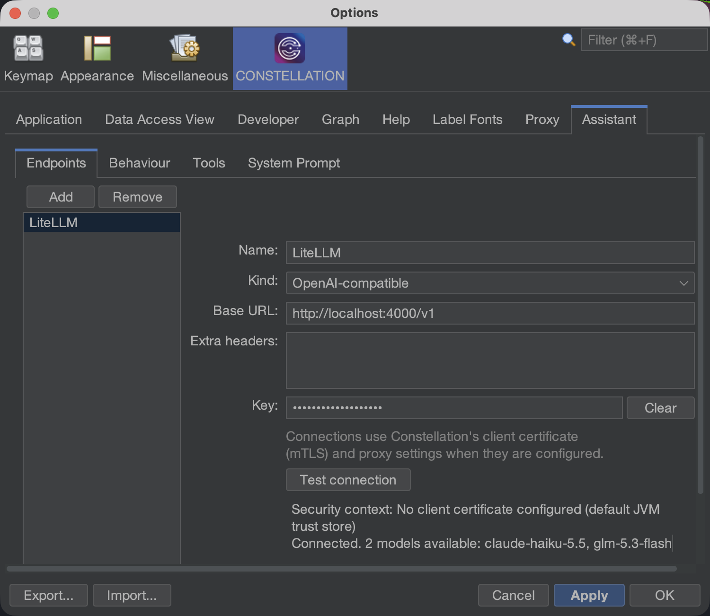

4. Click **OK**, then pick a model from the **model drop-down** at the top of the Assistant (you can also
   type a model id). The model you choose is remembered for each endpoint.

   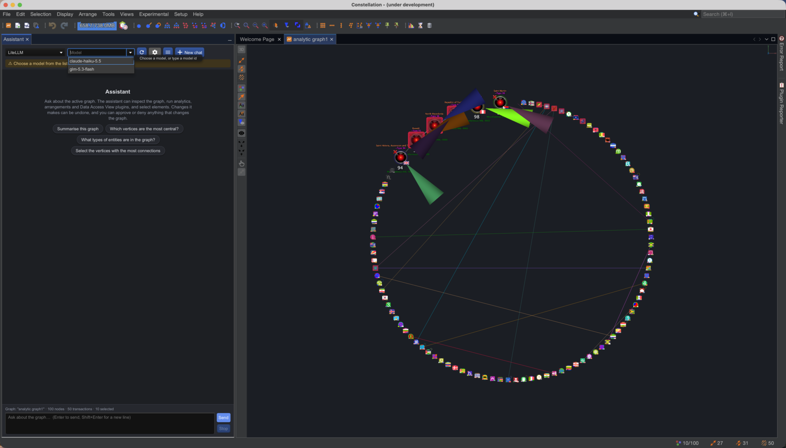

The **Behaviour** tab sets the default endpoint, step and result-size limits, default temperature and
reasoning effort; the **Tools** tab sets each tool's policy; the **System Prompt** tab lets you replace the
instructions sent to the model.

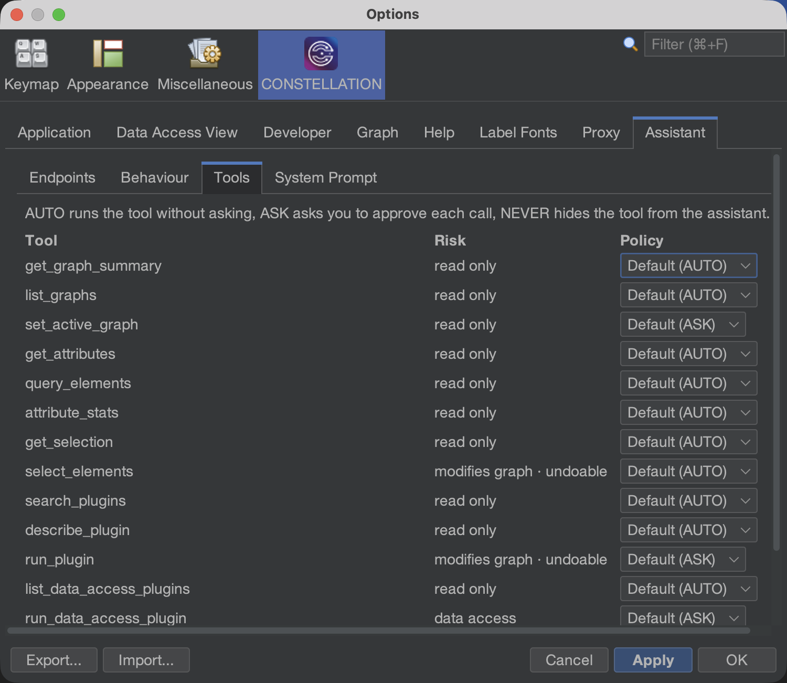

### Example: LiteLLM

LiteLLM speaks both APIs, so it can be added twice — once as *OpenAI-compatible* and once as *Anthropic* —
with the same base URL (`http://localhost:4000/v1`) and key. Both were used in testing with
`claude-haiku-5.5` and `glm-5.3-flash`.

---

## Using the Assistant

Type a question and press <kbd>Enter</kbd> (<kbd>Shift+Enter</kbd> for a new line), or click one of the
suggestions. Tool calls appear as cards while the assistant works, followed by its answer.

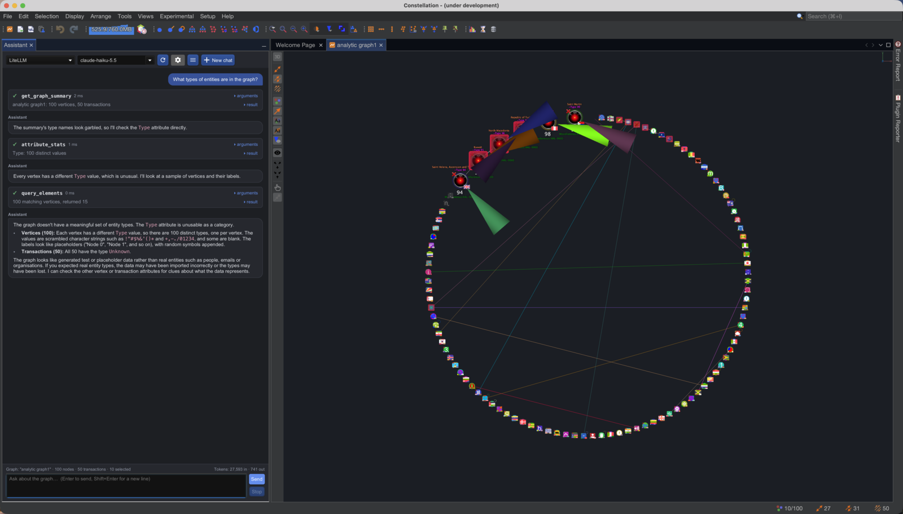

When the assistant wants to change the graph it asks first:

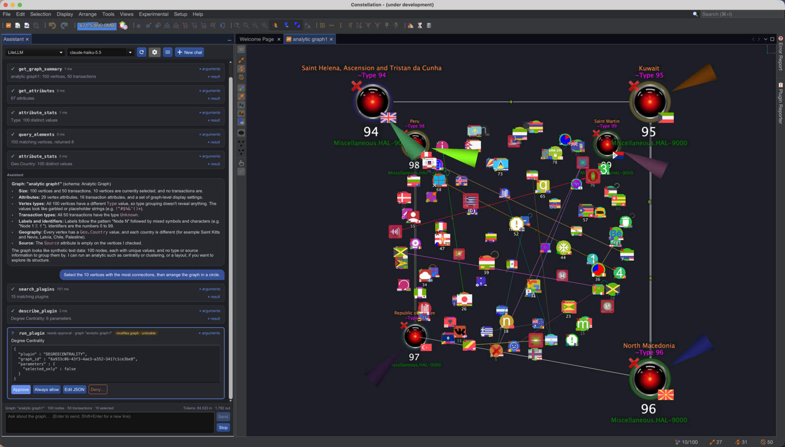

Here it was asked to *"Select the 10 vertices with the most connections, then arrange the graph in a
circle"*: it found and ran **Degree Centrality**, picked the top 10 (explaining how it broke ties),
cleared the selection so the layout applied to the whole graph, ran **Arrange in Circle** and restored the
selection — asking for approval before each change.

You can switch endpoint or model mid-chat. Below, the same conversation continues on GLM through the
Anthropic API, which plans to undo the layout and asks before running `undo_last_change`:

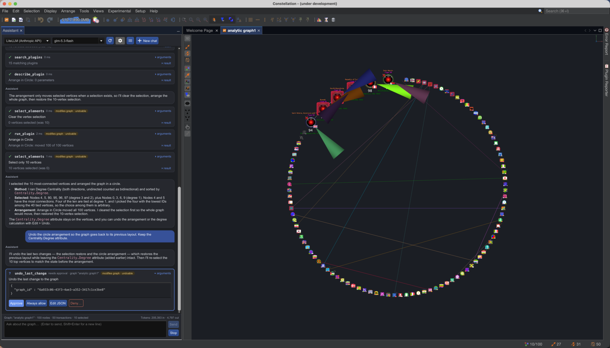

Press **■ Stop** at any time to stop the assistant, and **+ New chat** to start again. ⋯ > *Help* opens this
README.

> **Privacy:** your messages, a summary of the active graph and the results of the tools the assistant
> uses (which can include attribute values) are sent to the endpoint you select.

---

## Building the plugin

### Prerequisites

| Requirement | Version | Notes |
|---|---|---|
| JDK with JavaFX | 21 | Constellation needs JavaFX from the JDK, e.g. [Azul Zulu 21 JDK FX](https://www.azul.com/downloads/?version=java-21-lts&package=jdk-fx). |
| NetBeans platform | 21 | The [Apache NetBeans 21](https://netbeans.apache.org/) binary zip; the build uses its `platform` cluster and `harness`. |
| Apache Ant | 1.10+ | e.g. `brew install ant`. |
| A built Constellation | matching the target | A Constellation checkout built with Ant (it produces `build/cluster`). The plugin compiles against those modules. |
| Internet access (first build) | | [Apache Ivy](https://ant.apache.org/ivy/) downloads the third-party jars from Maven Central into `AiAgentView/release/modules/ext/`. |

On macOS, if NetBeans was downloaded with a browser, clear the quarantine flag once or its native
libraries won't load: `xattr -dr com.apple.quarantine /path/to/netbeans`.

### 1. Build Constellation

```sh
git clone https://github.com/constellation-app/constellation.git
cd constellation
ant -Dnbplatform.active.dir=$NB \
    -Dnbplatform.default.netbeans.dest.dir=$NB \
    -Dnbplatform.default.harness.dir=$NB/harness \
    -Dupdate.dependencies=true update-dependencies-clean-build
```

where `$NB` is the NetBeans install directory and `JAVA_HOME` points at the JavaFX JDK.

### 2. Build the plugin

Clone this repository next to the Constellation checkout (or point `CONSTELLATION_DIR` at it) and run:

```sh
export JAVA_HOME_FX=/path/to/zulu21-fx-jdk      # JDK with JavaFX
export NETBEANS_HOME=/path/to/netbeans           # default: ~/Tools/netbeans
export CONSTELLATION_DIR=../constellation        # default: ../constellation

./build.sh            # builds build/updates/*.nbm and updates.xml
./build.sh test       # runs the unit tests
./build.sh clean nbms # clean rebuild
```

`build.sh` is a thin wrapper around the NetBeans harness; the equivalent Ant command is

```sh
ant -Dnbplatform.active.dir=$NB -Dnbplatform.default.netbeans.dest.dir=$NB \
    -Dnbplatform.default.harness.dir=$NB/harness \
    -Dconstellation.dir=/path/to/constellation nbms
```

You can also set `constellation.dir` (or `constellation.cluster`, which points straight at a
`constellation` cluster directory, e.g. from an extracted Constellation release) in
`nbproject/private/platform-private.properties`.

Output, in `build/updates/`:

```
au-gov-asd-tac-constellation-views-aiagent.nbm   the plugin (≈1.5 MB, includes its libraries)
updates.xml                                      update-centre catalogue describing it
licenses/                                        licence text referenced by updates.xml
```

### Tests

`./build.sh test` runs the unit tests (agent loop, tools, settings, schema generation, UI). An integration
test also talks to a real endpoint when these are set (it is skipped otherwise):

```sh
LLM_TEST_URL=http://localhost:4000/v1 \
LLM_TEST_MODELS=claude-haiku-5.5,glm-5.3-flash \
LLM_TEST_API_KEY=... \
./build.sh test
```

It lists models and runs a tool-calling round trip for every model over both the OpenAI-compatible and
Anthropic APIs.

### Running Constellation with the plugin while developing

Run Constellation as usual (`ant run` in the Constellation checkout) and install
`build/updates/au-gov-asd-tac-constellation-views-aiagent.nbm` with **Setup > Plugins > Downloaded**. With
`ant run` the user directory is `constellation/build/testuserdir`; delete it to start from a clean
install. To install a rebuilt plugin, either uninstall the old one first or
[bump the version](#versioning).

---

## Distributing the plugin

The plugin is a standard NetBeans module (`.nbm`), so it can be distributed in either of the ways
Constellation's Plugin Manager supports:

1. **Share the `.nbm` file** (email, file share, artefact repository). Users install it with
   **Setup > Plugins > Downloaded > Add Plugins…** ([Option A](#option-a--install-the-nbm-file)).
2. **Publish an update centre.** Copy the whole `build/updates/` directory (`updates.xml`, the `.nbm` and
   `licenses/`) to a web server or shared drive. Users add the URL of `updates.xml` under
   **Setup > Plugins > Settings** ([Option B](#option-b--install-from-an-update-centre)) and then get new
   versions automatically through the **Updates** tab. An update centre can list several plugins; it's an
   ordinary NetBeans [update center](https://netbeans.apache.org/wiki/main/netbeansdevelopperfaq/DevFaqUpdateCenter/).

### Continuous integration and releases

[`.github/workflows/build.yml`](.github/workflows/build.yml) builds the plugin on GitHub Actions:

- **Every push and pull request to `main`** builds the `.nbm`, runs the unit tests (the live LLM
  integration tests are skipped) and attaches the `.nbm` to the workflow run as an artifact.
- **Pushing a tag like `v1.1.0`** does the same, sets the plugin's version to the tag, and publishes a
  GitHub Release with the `.nbm` attached:

  ```sh
  git tag v1.1.0
  git push origin v1.1.0
  ```

The workflow compiles against Constellation built from source at the commit in `CONSTELLATION_REF`
(cached, so only the first run builds Constellation). Change it to target a different Constellation.

### Versioning

Constellation decides whether a plugin is new or an update by its specification version
(`OpenIDE-Module-Specification-Version` in `AiAgentView/manifest.mf`). Releases built by CI take it from
the tag; for local builds, bump it by hand (e.g. `1.0` → `1.1`) for every release you distribute.

### Signing the NBM

Unsigned plugins install, but Constellation warns the user first. To sign the NBM, create (or use your
organisation's) Java keystore and pass it to the build — these are standard NetBeans harness properties:

```sh
keytool -genkeypair -alias constellation-ai -keyalg RSA -keysize 3072 -validity 3650 \
        -keystore constellation-ai.jks

./build.sh nbms -Dkeystore=/path/to/constellation-ai.jks -Dnbm_alias=constellation-ai -Dstorepass=...
```

The installer groups plugins as *signed and valid*, *self signed* or *unsigned*, so a self-signed
certificate is still flagged; use a certificate your users' JDK trusts to avoid the prompt.

### Compatibility

The NBM declares dependencies on the Constellation and NetBeans modules it uses (for example
`au.gov.asd.tac.constellation.graph > 1.0.6`). The Plugin Manager refuses to install it if they are
missing. Build the plugin against the Constellation version you are distributing to; rebuild it if
Constellation's public APIs change.

---

## How it works

Constellation is a NetBeans Platform application, and it already ships the NetBeans **Plugin Manager**
(*Setup > Plugins*, the `autoupdate` modules). That is the mechanism this plugin uses — nothing in
Constellation was changed:

- **Built outside the Constellation code base.** This repository is a separate NetBeans module suite.
  `nbproject/platform.properties` sets its `cluster.path` to the NetBeans `platform` cluster plus a built
  Constellation's `build/cluster`, so the plugin compiles against Constellation's public APIs (graph,
  plugins, data access, views, preferences, security, ...) exactly like a core module, without the source.
- **One self-contained NBM.** The plugin module bundles the jars it needs that Constellation doesn't
  provide — LangChain4j's core, OpenAI and Anthropic clients and JDK HTTP transport, plus `mutiny-zero` —
  as class-path extensions under `modules/ext/constellation-ai/`. Libraries Constellation already ships
  (Jackson, slf4j, jspecify) come from its `CoreDependencies` module instead, so there is only one copy of
  each class. Ivy (`AiAgentView/ivy.xml`) fetches the bundled jars non-transitively at build time.
- **Installed into the user directory.** The Plugin Manager unpacks the NBM into the Constellation user
  directory (`modules/`, `config/Modules/`, `update_tracking/`) and enables the module straight away, so no
  restart is needed. The module registers itself through the normal NetBeans mechanisms: a `TopComponent`
  (the view, in *Views*), an options panel (*Setup > Options > Constellation > Assistant*) and
  `@ServiceProvider` tool implementations.
- **Talking to models.** `LangChain4jProvider` adapts LangChain4j's streaming chat models (OpenAI-compatible
  or Anthropic) to the plugin's own `LlmProvider` interface. HTTP goes through a JDK `HttpClient` configured
  with Constellation's security context (client certificate) and proxy selector.
- **The agent loop.** `AgentSession` sends the conversation plus tool definitions to the model, streams
  the reply, validates any tool calls against their JSON schemas, asks the user when a tool's policy is ASK,
  runs the tool, and feeds the result back, until the model answers or the step limit is reached. To keep the
  conversation within budget, large tool results are truncated and older ones are compacted into one-line
  summaries; secrets are redacted from debug logs. Constellation plugins are exposed to the
  model by generating JSON schemas from their `PluginParameters`.

---

## Repository layout

```
constellation-ai/
├── build.sh                    build helper (wraps the NetBeans harness)
├── build.xml, nbproject/       the module suite (platform = NetBeans + a built Constellation)
├── ivysettings.xml             Maven Central resolver for the bundled jars
├── LICENSE                     Apache 2.0
├── docs/screenshots/           screenshots used in this README
└── AiAgentView/                the plugin module (au.gov.asd.tac.constellation.views.aiagent)
    ├── ivy.xml                 third-party jars bundled into the NBM
    ├── manifest.mf             module name and specification version
    ├── nbproject/project.xml   module dependencies, public API package, bundled jars
    ├── src/…/aiagent/
    │   ├── agent/              agent loop, history compaction, redaction, argument validation
    │   ├── api/                public API: AgentTool, ToolResult, ToolRisk, ToolPolicy, ToolContext
    │   ├── llm/                LLM abstraction, LangChain4j adapter, Constellation-aware HTTP client
    │   ├── preferences/        options panel and settings storage
    │   ├── tools/              the built-in tools and plugin-parameter JSON schemas
    │   └── ui/                 the Assistant view (JavaFX)
    └── test/unit/src/          unit and integration tests
```

## Licence

Apache License 2.0 — see [LICENSE](LICENSE).
